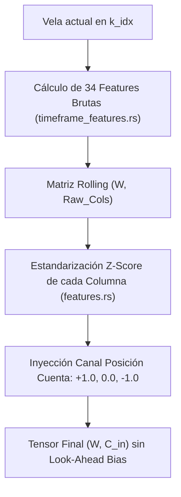

# 🌌 Astro EVO — Manual Maestro de Arquitectura, Especificación Matemática y Referencia de Código

> **Documento de Ingeniería Cuantitativa de Máxima Profundidad**  
> **Proyecto:** Astro EVO  
> **Lenguaje:** 100% Rust (Edición 2021)  
> **Compilador y Herramientas:** `rustc 1.75+`, perfiles `opt-level = 3`, `lto = "fat"`  
> **Librerías Core:** `ndarray` (0.16.1), `rayon` (1.10.0), `tokio` (1.49.0), `mimalloc` (0.1.43), `rusqlite` (0.38.0), `reqwest` (0.12)  
> **Reglas Críticas de Finanzas:** Causalidad temporal estricta (0% Look-Ahead Bias), Inmunidad a Liquidaciones (Triple Barrera), Simulación Dual (Nominal Fijo vs Compuesto Porcentual).

---

## 📑 Índice General
1. [Arquitectura de Procesos y Concurrencia Bare-Metal](#1-arquitectura-de-procesos-y-concurrencia-bare-metal)
2. [Red Neuronal Convolucional 1D: Implementación Analítica Completa](#2-red-neuronal-convolucional-1d-implementación-analítica-completa)
3. [Catálogo Exhaustivo de Características (Features) y Prueba de Causalidad](#3-catálogo-exhaustivo-de-características-features-y-prueba-de-causalidad)
4. [Método de la Triple Barrera (Triple Barrier Method) y Protección de Margen](#4-método-de-la-triple-barrera-triple-barrier-method-y-protección-de-margen)
5. [Métricas de Aptitud (Fitness) y Algoritmo de Ranking Multicriterio](#5-métricas-de-aptitud-fitness-y-algoritmo-de-ranking-multicriterio)
6. [Simulación Causal, Backtesting Dual y Aprendizaje Online](#6-simulación-causal-backtesting-dual-y-aprendizaje-online)
7. [Optimizador Evolutivo Genético por Bloques Coordinados (`EvoOptimizer`)](#7-optimizador-evolutivo-genético-por-bloques-coordinados-evooptimizer)
8. [Optimización por Bloques con Mutación de Inteligencia L](#8-optimización-por-bloques-con-mutación-de-inteligencia-l)
9. [Motor de Ejecución en Vivo (Live Trading Engine)](#9-motor-de-ejecución-en-vivo-live-trading-engine)
10. [Persistencia SQLite de Alta Concurrencia](#10-persistencia-sqlite-de-alta-concurrencia)
11. [Motor de Auditoría Financiera: 27 Métricas Myfxbook](#11-motor-de-auditoría-financiera-27-métricas-myfxbook)

---

## 1. Arquitectura de Procesos y Concurrencia Bare-Metal

Astro EVO no ejecuta scripts interpretados ni bindings con sobrecarga. Toda la infraestructura se compila a código de máquina nativo.

### 1.1. Asignación de Memoria y Afinidad de Hardware
En [`src/main.rs#L13-L42`](file:///c:/Users/Allianz/Downloads/Antigravity/Astro%20EVO/src/main.rs#L13-L42):
- **Gestor de Memoria MiMalloc:**
  ```rust
  #[global_allocator]
  static GLOBAL: mimalloc::MiMalloc = mimalloc::MiMalloc;
  ```
  Evita los bloqueos de bloqueo mutuo (mutex contention) del asignador estándar de Windows en cargas de trabajo de cientos de miles de matrices creadas y destruidas por segundo en `rayon`.
- **Afinidad de Núcleos de CPU (Windows API):**
  [`src/main.rs#L16-L34`](file:///c:/Users/Allianz/Downloads/Antigravity/Astro%20EVO/src/main.rs#L16-L34):
  ```rust
  #[cfg(target_os = "windows")]
  unsafe extern "system" {
      fn GetCurrentProcess() -> *mut std::ffi::c_void;
      fn SetProcessAffinityMask(h_process: *mut std::ffi::c_void, dw_process_affinity_mask: usize) -> i32;
  }
  ```
  Si el sistema cuenta con más de 4 núcleos, el proceso calcula una máscara de bits `mask = (1 << (cores - 4)) - 1` para aislar los hilos pesados de cómputo numérico, dejando 4 núcleos libres para el sistema operativo, buffers de red y llamadas al disco.
- **Rayon ThreadPool:** Inicializado explícitamente en [`src/main.rs#L39-L41`](file:///c:/Users/Allianz/Downloads/Antigravity/Astro%20EVO/src/main.rs#L39-L41) con 28 hilos de trabajo paralelos.

---

## 2. Red Neuronal Convolucional 1D: Implementación Analítica Completa

Ubicada íntegramente en [`src/cnn1d.rs`](file:///c:/Users/Allianz/Downloads/Antigravity/Astro%20EVO/src/cnn1d.rs).

### 2.1. Capa Convolucional 1D (`Conv1D`)
- **Estructura de Datos ([`src/cnn1d.rs#L4-L13`](file:///c:/Users/Allianz/Downloads/Antigravity/Astro%20EVO/src/cnn1d.rs#L4-L13)):**
  ```rust
  pub struct Conv1D {
      pub in_channels: usize,
      pub out_channels: usize,
      pub kernel_size: usize,
      pub weights: Array3<f32>, // Forma: (out_channels, in_channels, kernel_size)
      pub bias: Array1<f32>,    // Forma: (out_channels)
      pub last_input: Option<Array2<f32>>,
  }
  ```
- **Inicialización He Uniforme ([`src/cnn1d.rs#L87-L106`](file:///c:/Users/Allianz/Downloads/Antigravity/Astro%20EVO/src/cnn1d.rs#L87-L106)):**
  El límite se calcula como $\text{limit} = \sqrt{\frac{6.0}{(C_{\text{in}} \cdot K + C_{\text{out}} \cdot K)}}$.
  Los pesos se inicializan pseudoaleatoriamente mediante un generador congruencial lineal determinista: `seed = seed.wrapping_mul(1664525).wrapping_add(1013904223)`.
- **Pase Hacia Adelante (Forward Discreto) ([`src/cnn1d.rs#L113-L134`](file:///c:/Users/Allianz/Downloads/Antigravity/Astro%20EVO/src/cnn1d.rs#L113-L134)):**
  Dado un tensor de entrada $X \in \mathbb{R}^{W \times C_{\text{in}}}$, la dimensión temporal de salida es $W_{\text{out}} = W - K + 1$. Para cada canal de salida $o$ y cada instante temporal $t \in [0, W_{\text{out}} - 1]$:
  $$\text{out}[t, o] = \text{bias}[o] + \sum_{c=0}^{C_{\text{in}}-1} \sum_{k=0}^{K-1} X[t + k, c] \cdot \text{weights}[o, c, k]$$
- **Retropropagación Analítica (Backward Pass) ([`src/cnn1d.rs#L136-L201`](file:///c:/Users/Allianz/Downloads/Antigravity/Astro%20EVO/src/cnn1d.rs#L136-L201)):**
  Dado el gradiente entrante $\delta \in \mathbb{R}^{W_{\text{out}} \times C_{\text{out}}}$:
  $$\frac{\partial L}{\partial \text{bias}[o]} = \sum_{t=0}^{W_{\text{out}}-1} \delta[t, o]$$
  $$\frac{\partial L}{\partial \text{weights}[o, c, k]} = \sum_{t=0}^{W_{\text{out}}-1} \delta[t, o] \cdot X[t + k, c]$$
  $$\frac{\partial L}{\partial X[t+k, c]} = \sum_{o=0}^{C_{\text{out}}-1} \delta[t, o] \cdot \text{weights}[o, c, k]$$

### 2.2. Capa Densa (`Dense`)
- **Estructura de Datos ([`src/cnn1d.rs#L204-L210`](file:///c:/Users/Allianz/Downloads/Antigravity/Astro%20EVO/src/cnn1d.rs#L204-L210)):**
  `weights: Array2<f32>` de dimensión $(D_{\text{in}}, D_{\text{out}})$, `bias: Array1<f32>` de dimensión $(D_{\text{out}})$.
- **Forward ([`src/cnn1d.rs#L236-L242`](file:///c:/Users/Allianz/Downloads/Antigravity/Astro%20EVO/src/cnn1d.rs#L236-L242)):**
  $$Z = X \cdot W + b$$
- **Backward ([`src/cnn1d.rs#L244-L293`](file:///c:/Users/Allianz/Downloads/Antigravity/Astro%20EVO/src/cnn1d.rs#L244-L293)):**
  $$\frac{\partial L}{\partial W} = X^T \cdot \delta, \quad \frac{\partial L}{\partial b} = \sum_{\text{filas}} \delta, \quad \frac{\partial L}{\partial X} = \delta \cdot W^T$$

### 2.3. Optimizador AdamW con Regularización L1 y Gradient Clipping
Implementado en [`src/cnn1d.rs#L16-L55`](file:///c:/Users/Allianz/Downloads/Antigravity/Astro%20EVO/src/cnn1d.rs#L16-L55):
```rust
pub fn update_adam_param_slice(
    weights: &mut [f32], grads: &[f32], m: &mut [f32], v: &mut [f32],
    lr: f32, wd: f32, l1_lambda: f32, t: f32,
) {
    let beta1 = 0.9f32;
    let beta2 = 0.999f32;
    let eps = 1e-8f32;
    let correction1 = 1.0 - beta1.powf(t);
    let correction2 = 1.0 - beta2.powf(t);
    let l1_penalty = lr * l1_lambda;
    let lr_decay_factor = 1.0 - lr * wd;

    for i in 0..weights.len() {
        let g = grads[i];
        m[i] = beta1 * m[i] + (1.0 - beta1) * g;
        v[i] = beta2 * v[i] + (1.0 - beta2) * (g * g);

        let m_hat = m[i] / correction1;
        let v_hat = v[i] / correction2;

        // 1. Decaimiento de Pesos Desacoplado (L2 / AdamW)
        let mut w = weights[i] * lr_decay_factor;

        // 2. Operador de Umbral Suave (L1 Lasso Sparsity)
        if w > l1_penalty {
            w -= l1_penalty;
        } else if w < -l1_penalty {
            w += l1_penalty;
        } else {
            w = 0.0;
        }

        // 3. Actualización de momentos Adam
        weights[i] = w - (lr * m_hat / (v_hat.sqrt() + eps));
    }
}
```
- **Gradient Clipping In-Place:** Antes de llamar al optimizador ([`src/cnn1d.rs#L173-L180`](file:///c:/Users/Allianz/Downloads/Antigravity/Astro%20EVO/src/cnn1d.rs#L173-L180)), se calcula la norma $L_2$:
  ```rust
  let dw_norm: f32 = dw_slice.iter().map(|&val| val * val).sum::<f32>().sqrt();
  if dw_norm > 1.0 {
      let inv_norm = 1.0 / dw_norm;
      for val in dw_slice.iter_mut() { *val *= inv_norm; }
  }
  ```

### 2.4. Global Average Pooling (GAP) e Inferencia
En [`src/cnn1d.rs#L510-L527`](file:///c:/Users/Allianz/Downloads/Antigravity/Astro%20EVO/src/cnn1d.rs#L510-L527):
1. **Convolución 1 y ReLU:** $h_1 = \max(0, \text{Conv1}(X))$.
2. **Convolución 2 y ReLU:** $h_2 = \max(0, \text{Conv2}(h_1))$.
3. **GAP:** Promedia la dimensión temporal $W_{\text{gap}}$:
   $$\text{gap}[c] = \frac{1}{W_{\text{gap}}} \sum_{t=0}^{W_{\text{gap}}-1} h_2[t, c]$$
4. **Softmax Numéricamente Estable:**
   $$M = \max_i(z_i), \quad P(y = i) = \frac{e^{z_i - M}}{\sum_j e^{z_j - M}}$$

### 2.5. Paso de Entrenamiento con Label Smoothing
En [`src/cnn1d.rs#L627-L712`](file:///c:/Users/Allianz/Downloads/Antigravity/Astro%20EVO/src/cnn1d.rs#L627-L712):
- Con factor $\epsilon = 0.15$:
  $$\text{target\_probs}[i] = \frac{\epsilon}{3.0} + (1.0 - \epsilon) \cdot \mathbb{I}(i = y)$$
- Pérdida Cross-Entropy suavizada:
  $$\mathcal{L} = - \sum_{i=0}^2 \text{target\_probs}[i] \cdot \ln(P_i + 10^{-15})$$
- Gradiente inicial de salida densa:
  $$\frac{\partial \mathcal{L}}{\partial z_i} = P_i - \text{target\_probs}[i]$$

---

## 3. Catálogo Exhaustivo de Características (Features) y Prueba de Causalidad

Implementado en [`src/features/timeframe_features.rs#L12-L209`](file:///c:/Users/Allianz/Downloads/Antigravity/Astro%20EVO/src/features/timeframe_features.rs#L12-L209). Cada cálculo utiliza exclusivamente velas con índice $j \le k\_idx$.



### 3.1. Especificación Matemática Detallada de las 34 Features

1. **$f_1$ — Volumen Relativo a Largo Plazo ([`L34`](file:///c:/Users/Allianz/Downloads/Antigravity/Astro%20EVO/src/features/timeframe_features.rs#L34)):**
   $$f_1 = \frac{V_t}{\text{SMA}_{10000}(V)_t}$$
2. **$f_2$ — Rango Total Normalizado ([`L35`](file:///c:/Users/Allianz/Downloads/Antigravity/Astro%20EVO/src/features/timeframe_features.rs#L35)):**
   $$f_2 = \frac{H_t - L_t}{O_t}$$
3. **$f_3$ — Longitud de Mecha Superior ([`L36`](file:///c:/Users/Allianz/Downloads/Antigravity/Astro%20EVO/src/features/timeframe_features.rs#L36)):**
   $$f_3 = \frac{H_t - O_t}{O_t}$$
4. **$f_4$ — Longitud de Mecha Inferior ([`L37`](file:///c:/Users/Allianz/Downloads/Antigravity/Astro%20EVO/src/features/timeframe_features.rs#L37)):**
   $$f_4 = \frac{O_t - L_t}{O_t}$$
5. **$f_5$ — Cuerpo de la Vela Firmado ([`L38`](file:///c:/Users/Allianz/Downloads/Antigravity/Astro%20EVO/src/features/timeframe_features.rs#L38)):**
   $$f_5 = \frac{O_t - C_t}{O_t}$$
6. **$f_6$ — Momentum Retrospectivo a 10 Periodos ([`L39`](file:///c:/Users/Allianz/Downloads/Antigravity/Astro%20EVO/src/features/timeframe_features.rs#L39)):**
   $$f_6 = \frac{C_t - C_{t-10}}{C_{t-10}}$$
7. **$f_7$ — Pendiente de Regresión Lineal de 10 Velas ([`L41-L47`](file:///c:/Users/Allianz/Downloads/Antigravity/Astro%20EVO/src/features/timeframe_features.rs#L41-L47)):**
   Con $x_i = i - 4.5$ para $i \in [0, 9]$: $\sum x_i^2 = 82.5$.
   $$\text{Slope} = \frac{\sum_{i=0}^9 (i - 4.5) \cdot C_{t-9+i}}{82.5}, \quad f_7 = \frac{\text{Slope}}{C_t}$$
8. **$f_8$ — Oscilador de Posición en Rango de 10 Velas ([`L49-L58`](file:///c:/Users/Allianz/Downloads/Antigravity/Astro%20EVO/src/features/timeframe_features.rs#L49-L58)):**
   $$f_8 = \frac{C_t - \min_{j \in [0, 9]}(L_{t-j})}{\max_{j \in [0, 9]}(H_{t-j}) - \min_{j \in [0, 9]}(L_{t-j})}$$
9. **$f_9$ — Z-Score Local del Cierre a 10 Barras ([`L60-L72`](file:///c:/Users/Allianz/Downloads/Antigravity/Astro%20EVO/src/features/timeframe_features.rs#L60-L72)):**
   $$\mu_{10} = \frac{1}{10}\sum_{j=0}^9 C_{t-j}, \quad \sigma_{10} = \sqrt{\frac{1}{10}\sum_{j=0}^9 (C_{t-j} - \mu_{10})^2}, \quad f_9 = \frac{C_t - \mu_{10}}{\sigma_{10}}$$
10. **$f_{10}$ — True Range Medio (ATR 10) Relativo ([`L73-L84`](file:///c:/Users/Allianz/Downloads/Antigravity/Astro%20EVO/src/features/timeframe_features.rs#L73-L84)):**
    $$\text{TR}_j = \max(H_j - L_j, |H_j - C_{j-1}|, |L_j - C_{j-1}|), \quad f_{10} = \frac{\frac{1}{10}\sum_{j=0}^9 \text{TR}_{t-j}}{C_t}$$
11. **$f_{11}$ — Régimen de Mercado de Markov en $t$ ([`L86-L88`](file:///c:/Users/Allianz/Downloads/Antigravity/Astro%20EVO/src/features/timeframe_features.rs#L86-L88)):**
    Calculado en [`src/indicators.rs#L171-L236`](file:///c:/Users/Allianz/Downloads/Antigravity/Astro%20EVO/src/indicators.rs#L171-L236). Combina tendencia (SMA 10 y pendiente) y volatilidad (NATR actual vs NATR promedio de 10 barras). Devuelve un estado discreto entre $0$ y $5$, dividido por $5.0$.
12. **$f_{12}$ — Régimen de Markov en $t-1$ ([`L87-L89`](file:///c:/Users/Allianz/Downloads/Antigravity/Astro%20EVO/src/features/timeframe_features.rs#L87-L89)):**
    `compute_markov_state(klines, k_idx - 1) / 5.0`.
13. **$f_{13}$ — Volumen Relativo a Corto Plazo (SMA 20) ([`L91`](file:///c:/Users/Allianz/Downloads/Antigravity/Astro%20EVO/src/features/timeframe_features.rs#L91)):**
    $$f_{13} = \frac{V_t}{\text{SMA}_{20}(V)_t}$$
14. **$f_{14}$ — Aceleración de Volumen ([`L92`](file:///c:/Users/Allianz/Downloads/Antigravity/Astro%20EVO/src/features/timeframe_features.rs#L92)):**
    $$f_{14} = \frac{\text{SMA}_5(V)_t}{\text{SMA}_{20}(V)_t}$$
15. **$f_{15}$ — Eficiencia Esfuerzo / Resultado ([`L93`](file:///c:/Users/Allianz/Downloads/Antigravity/Astro%20EVO/src/features/timeframe_features.rs#L93)):**
    $$f_{15} = \frac{f_2}{f_{13} + 10^{-5}}$$
16. **$f_{16}$ — Histograma MACD Normalizado ([`L94`](file:///c:/Users/Allianz/Downloads/Antigravity/Astro%20EVO/src/features/timeframe_features.rs#L94)):**
    $$f_{16} = \frac{\text{MACD\_Hist}_t}{C_t}, \quad \text{con } \alpha_{12} = \frac{2}{13}, \alpha_{26} = \frac{2}{27}, \alpha_9 = \frac{2}{10}$$
17. **$f_{17}$ — Desviación Porcentual a EMA 20 ([`L96`](file:///c:/Users/Allianz/Downloads/Antigravity/Astro%20EVO/src/features/timeframe_features.rs#L96)):**
    $$f_{17} = \frac{C_t - \text{EMA}_{20}(C)_t}{\text{EMA}_{20}(C)_t}$$
18. **$f_{18}$ — Aceleración de Pendiente (Segunda Derivada) ([`L98-L105`](file:///c:/Users/Allianz/Downloads/Antigravity/Astro%20EVO/src/features/timeframe_features.rs#L98-L105)):**
    $$f_{18} = \frac{\text{Slope}_t - \text{Slope}_{t-1}}{C_t}$$
19. **$f_{19}$ — Distancia al Nivel Macro EMA 200 de Precios Medios ([`L107`](file:///c:/Users/Allianz/Downloads/Antigravity/Astro%20EVO/src/features/timeframe_features.rs#L107)):**
    $$f_{19} = \frac{C_t - \text{EMA}_{200}\left(\frac{H+L}{2}\right)_t}{\text{EMA}_{200}\left(\frac{H+L}{2}\right)_t}$$
20. **$f_{20}$ — Ratio de Régimen de Volatilidad ([`L108`](file:///c:/Users/Allianz/Downloads/Antigravity/Astro%20EVO/src/features/timeframe_features.rs#L108)):**
    $$f_{20} = \frac{\text{ATR}_5(t)}{\text{ATR}_{50}(t)}$$
21. **$f_{21}$ — Bandera Booleana de Tendencia Alcista Macro ([`L109`](file:///c:/Users/Allianz/Downloads/Antigravity/Astro%20EVO/src/features/timeframe_features.rs#L109)):**
    $$f_{21} = \mathbb{I}\left(C_t > \text{EMA}_{200}\left(\frac{H+L}{2}\right)_t\right)$$
22. **$f_{22}$ — Kaufman Efficiency Ratio a 10 Periodos ([`L111-L116`](file:///c:/Users/Allianz/Downloads/Antigravity/Astro%20EVO/src/features/timeframe_features.rs#L111-L116)):**
    $$f_{22} = \frac{|C_t - C_{t-10}|}{\sum_{j=0}^9 |C_{t-j} - C_{t-j-1}|}$$
23. **$f_{23}$ — Volume Price Trend (VPT) Acumulado ([`L118-L122`](file:///c:/Users/Allianz/Downloads/Antigravity/Astro%20EVO/src/features/timeframe_features.rs#L118-L122)):**
    $$f_{23} = \frac{\sum_{j=0}^9 (C_{t-j} - C_{t-j-1}) \cdot V_{t-j}}{C_t \cdot \text{SMA}_{10000}(V)_t}$$
24. **$f_{24}$ — Amplitud Normalizada del Canal Donchian de 10 Velas ([`L124`](file:///c:/Users/Allianz/Downloads/Antigravity/Astro%20EVO/src/features/timeframe_features.rs#L124)):**
    $$f_{24} = \frac{\max_{j \in [0, 9]}(H_{t-j}) - \min_{j \in [0, 9]}(L_{t-j})}{\mu_{10}(C)}$$
25. **$f_{25}$ — Tasa de Cambio de Volatilidad Intrawindow ([`L125-L126`](file:///c:/Users/Allianz/Downloads/Antigravity/Astro%20EVO/src/features/timeframe_features.rs#L125-L126)):**
    $$f_{25} = \frac{f_{2, t} - f_{2, t-10}}{f_{2, t-10}}$$
26. **$f_{26}$ — Presión de Volumen Firmada con Amortiguación Logarítmica ([`L127`](file:///c:/Users/Allianz/Downloads/Antigravity/Astro%20EVO/src/features/timeframe_features.rs#L127)):**
    $$f_{26} = \text{sign}(C_t - O_t) \cdot \ln(V_t + 1.0)$$
27. **$f_{27}$ — Oscilador RSI de 14 Periodos Centrado en Cero ([`L129-L146`](file:///c:/Users/Allianz/Downloads/Antigravity/Astro%20EVO/src/features/timeframe_features.rs#L129-L146)):**
    $$U = \sum_{i=0}^{13} \max(C_{t-i} - C_{t-i-1}, 0), \quad D = \sum_{i=0}^{13} \max(C_{t-i-1} - C_{t-i}, 0)$$
    $$\text{RSI} = \frac{U}{U + D}, \quad f_{27} = \text{RSI} - 0.5$$
28. **$f_{28}$ & $f_{29}$ — Componentes Seno y Coseno de la Hora UTC ([`L152-L157`](file:///c:/Users/Allianz/Downloads/Antigravity/Astro%20EVO/src/features/timeframe_features.rs#L152-L157)):**
    $$f_{28} = \sin\left(\frac{2\pi \cdot \text{Hora}}{24}\right), \quad f_{29} = \cos\left(\frac{2\pi \cdot \text{Hora}}{24}\right)$$
    *(Excluidas en 1D al ser invariantes a 00:00 UTC).*
29. **$f_{30}$ & $f_{31}$ — Componentes Seno y Coseno del Día Semanal ([`L154-L159`](file:///c:/Users/Allianz/Downloads/Antigravity/Astro%20EVO/src/features/timeframe_features.rs#L154-L159)):**
    $$f_{30} = \sin\left(\frac{2\pi \cdot \text{Día}}{7}\right), \quad f_{31} = \cos\left(\frac{2\pi \cdot \text{Día}}{7}\right)$$
30. **$f_{32}$ — Volatilidad de Parkinson de 10 Periodos ([`L161-L170`](file:///c:/Users/Allianz/Downloads/Antigravity/Astro%20EVO/src/features/timeframe_features.rs#L161-L170)):**
    $$f_{32} = \sqrt{\frac{1}{40 \ln 2} \sum_{i=0}^9 \ln^2\left(\frac{H_{t-i}}{L_{t-i}}\right)}$$
31. **$f_{33}$ — Diferenciación Fraccionaria ($d \approx 0.4$) ([`L172-L179`](file:///c:/Users/Allianz/Downloads/Antigravity/Astro%20EVO/src/features/timeframe_features.rs#L172-L179)):**
    Con coeficientes binomiales de memoria larga:
    `weights = [1.0, -0.4, -0.12, -0.064, -0.0416, -0.029952, -0.0229632, -0.01837056, -0.015155712, -0.0127981568]`.
    $$f_{33} = \sum_{k=0}^9 w_k \cdot (\ln C_{t-k} - \ln C_t)$$
32. **$f_{34}$ — Hora del Día Continua ([`L202-L206`](file:///c:/Users/Allianz/Downloads/Antigravity/Astro%20EVO/src/features/timeframe_features.rs#L202-L206)):**
    `hour / 23.0` agregada únicamente en modelos de 1H, 15m, 5m o 1m.
33. **Último Canal — Estado de Posición Actual de Cuenta ([`src/features.rs#L116-L119`](file:///c:/Users/Allianz/Downloads/Antigravity/Astro%20EVO/src/features.rs#L116-L119)):**
    Valores discretos: $+1.0$ (Long), $0.0$ (Flat), $-1.0$ (Short).

---

## 4. Método de la Triple Barrera (Triple Barrier Method) y Protección de Margen

Implementado en [`src/intelligence/labeling/triple_barrier.rs`](file:///c:/Users/Allianz/Downloads/Antigravity/Astro%20EVO/src/intelligence/labeling/triple_barrier.rs).

### 4.1. Definición de Barreras Dinámicas
En [`src/intelligence/labeling/triple_barrier.rs#L110-L122`](file:///c:/Users/Allianz/Downloads/Antigravity/Astro%20EVO/src/intelligence/labeling/triple_barrier.rs#L110-L122):
- $\text{ATR}_{\text{ratio}} = \max\left(\frac{\text{ATR}_{50}[t]}{C_t}, 0.001\right)$.
- $\text{pt\_pct} = \text{config.pt\_atr\_mult} \cdot \text{ATR}_{\text{ratio}}$.
- $\text{sl\_pct} = \min(\text{config.sl\_atr\_mult} \cdot \text{ATR}_{\text{ratio}}, \text{config.max\_loss\_cap})$.
- **Barreras LONG:** $\text{long\_tp} = C_t \cdot (1 + \text{pt\_pct})$, $\text{long\_sl} = C_t \cdot (1 - \text{sl\_pct})$.
- **Barreras SHORT:** $\text{short\_tp} = C_t \cdot (1 - \text{pt\_pct})$, $\text{short\_sl} = C_t \cdot (1 + \text{sl\_pct})$.

### 4.2. Evaluación Cronológica Anti-Liquidación
En [`src/intelligence/labeling/triple_barrier.rs#L128-L166`](file:///c:/Users/Allianz/Downloads/Antigravity/Astro%20EVO/src/intelligence/labeling/triple_barrier.rs#L128-L166):
```rust
for i in 1..=config.horizon {
    let next_k = &klines[idx + i];

    // Evaluación LONG
    if !long_stopped && long_hit_step.is_none() {
        let sl_hit = next_k.low <= long_sl;
        let tp_hit = next_k.high >= long_tp;
        if sl_hit && tp_hit {
            long_stopped = true; // Conservador: SL antes que TP en la misma vela
        } else if sl_hit {
            long_stopped = true;
        } else if tp_hit {
            long_hit_step = Some(i);
        }
    }

    // Evaluación SHORT
    if !short_stopped && short_hit_step.is_none() {
        let sl_hit = next_k.high >= short_sl;
        let tp_hit = next_k.low <= short_tp;
        if sl_hit && tp_hit {
            short_stopped = true;
        } else if sl_hit {
            short_stopped = true;
        } else if tp_hit {
            short_hit_step = Some(i);
        }
    }
}
```

---

## 5. Métricas de Aptitud (Fitness) y Algoritmo de Ranking Multicriterio

### 5.1. Regresión Lineal por Mínimos Cuadrados Ordinarios ($R^2$)
En [`src/metrics/linearity.rs#L21-L71`](file:///c:/Users/Allianz/Downloads/Antigravity/Astro%20EVO/src/metrics/linearity.rs#L21-L71):
- $S_{xx} = \sum (i - \bar{x})^2, \quad S_{yy} = \sum (\text{Eq}_i - \bar{y})^2, \quad S_{xy} = \sum (i - \bar{x})(\text{Eq}_i - \bar{y})$.
- Pendiente: $m = \frac{S_{xy}}{S_{xx}}$.
- Si $m \le 0$, se impone $R^2 = 0.0$ ([`L53-L56`](file:///c:/Users/Allianz/Downloads/Antigravity/Astro%20EVO/src/metrics/linearity.rs#L53-L56)).
- Si $m > 0$, $R^2 = \text{clamp}\left(\frac{S_{xy}^2}{S_{xx} \cdot S_{yy}}, 0.0, 1.0\right)$.
- **Score Compuesto IS/OOS ([`src/metrics/linearity.rs#L107-L111`](file:///c:/Users/Allianz/Downloads/Antigravity/Astro%20EVO/src/metrics/linearity.rs#L107-L111)):**
  $$\text{Composite } R^2 = 0.40 \cdot R^2_{\text{global}} + 0.35 \cdot \left(\frac{R^2_{\text{IS}} + R^2_{\text{OOS}}}{2}\right) + 0.25 \cdot \min(R^2_{\text{IS}}, R^2_{\text{OOS}})$$

### 5.2. Ulcer Index, Sortino Ratio y Suavidad
En [`src/metrics/smoothness.rs#L16-L85`](file:///c:/Users/Allianz/Downloads/Antigravity/Astro%20EVO/src/metrics/smoothness.rs#L16-L85):
- **Ulcer Index ([`L25-L41`](file:///c:/Users/Allianz/Downloads/Antigravity/Astro%20EVO/src/metrics/smoothness.rs#L25-L41)):**
  $$\text{UI} = \sqrt{\frac{1}{N} \sum_{i=1}^N \left(\frac{\text{Peak}_i - \text{Eq}_i}{\text{Peak}_i} \cdot 100\right)^2}$$
- **Sortino Ratio ([`L43-L73`](file:///c:/Users/Allianz/Downloads/Antigravity/Astro%20EVO/src/metrics/smoothness.rs#L43-L73)):**
  $$\text{Downside Dev} = \sqrt{\frac{1}{M}\sum_{pnl < 0} pnl^2}, \quad \text{Sortino} = \frac{\overline{pnl}}{\text{Downside Dev}}$$
- **Índice de Suavidad ([`L77`](file:///c:/Users/Allianz/Downloads/Antigravity/Astro%20EVO/src/metrics/smoothness.rs#L77)):**
  $$\text{Smoothness} = \frac{\text{Composite } R^2}{1.0 + \frac{\text{UI}}{10.0}} \in [0.0, 1.0]$$

### 5.3. Algoritmo de Ranking de Cuatro Factores
En [`src/metrics/ranking.rs#L15-L98`](file:///c:/Users/Allianz/Downloads/Antigravity/Astro%20EVO/src/metrics/ranking.rs#L15-L98):
$$\text{weighted\_avg\_rank} = \frac{\text{rank\_slope} + \text{rank\_cap\_dd} + \text{rank\_r2} + \text{rank\_smoothness}}{4.0}$$

---

## 6. Simulación Causal, Backtesting Dual y Aprendizaje Online

En [`src/online_learning.rs#L250-L729`](file:///c:/Users/Allianz/Downloads/Antigravity/Astro%20EVO/src/online_learning.rs#L250-L729):

### 6.1. Detección Matemática de Liquidación
En [`src/online_learning.rs#L320-L335`](file:///c:/Users/Allianz/Downloads/Antigravity/Astro%20EVO/src/online_learning.rs#L320-L335):
$$\text{pnl\_limit} = \frac{1}{\text{leverage}} - 0.0005$$
$$\text{precio\_liq} = \begin{cases} \text{entry} \cdot (1.0 - \text{pnl\_limit}) & \text{si Posición Long} \\ \text{entry} \cdot (1.0 + \text{pnl\_limit}) & \text{si Posición Short} \end{cases}$$
Si `low <= precio_liq` (Long) o `high >= precio_liq` (Short), la cuenta pierde el margen, suma comisión y `pos = 0.0`.

### 6.2. Umbral Dinámico de Señal y Ejecución
En [`src/online_learning.rs#L407-L417`](file:///c:/Users/Allianz/Downloads/Antigravity/Astro%20EVO/src/online_learning.rs#L407-L417):
$$\text{atr\_ratio} = \frac{\text{ATR}_{50}[i]}{C_i}$$
$$\text{dynamic\_thr} = \text{clamp}(0.40 + 0.15 \cdot (\text{atr\_ratio} \cdot 100), 0.40, 0.55)$$
- `pos_deseada = +1.0` si $P_{\text{long}} > P_{\text{short}} \land P_{\text{long}} > P_{\text{flat}} \land P_{\text{long}} > \text{dynamic\_thr}$.
- `pos_deseada = -1.0` si $P_{\text{short}} > P_{\text{long}} \land P_{\text{short}} > P_{\text{flat}} \land P_{\text{short}} > \text{dynamic\_thr}$.
- De lo contrario, `pos_deseada = 0.0`.

### 6.3. Comisiones y Reversión de Posición
En [`src/online_learning.rs#L424-L477`](file:///c:/Users/Allianz/Downloads/Antigravity/Astro%20EVO/src/online_learning.rs#L424-L477):
- Comisión de entrada: $\text{Notional} \cdot 0.0005$ ($0.05\%$).
- Comisión de salida: $\text{Notional}_{\text{cierre}} \cdot 0.0005$.
- PnL neto: $\text{PnL Bruto} - \text{Comisiones Totales}$.

### 6.4. Learning Rate Adaptativo por Drawdown
En [`src/online_learning.rs#L550-L553`](file:///c:/Users/Allianz/Downloads/Antigravity/Astro%20EVO/src/online_learning.rs#L550-L553):
$$\text{DD}_{\text{float}} = \text{clamp}\left(\frac{\text{peak} - \text{equity}}{\text{peak}}, 0.0, 0.5\right)$$
$$\text{adaptive\_factor} = 1.0 + 4.0 \cdot \text{DD}_{\text{float}}$$
$$\text{current\_lr} = \text{config.learning\_rate} \cdot \text{adaptive\_factor}$$

---

## 7. Optimizador Evolutivo Genético por Bloques Coordinados (`EvoOptimizer`)

En [`src/evo_optimizer.rs#L14-L153`](file:///c:/Users/Allianz/Downloads/Antigravity/Astro%20EVO/src/evo_optimizer.rs#L14-L153):

### 7.1. Generador de Números Pseudoaleatorios y Muestreador Gaussiano
- **Generador Congruencial de 64 Bits ([`L29-L32`](file:///c:/Users/Allianz/Downloads/Antigravity/Astro%20EVO/src/evo_optimizer.rs#L29-L32)):**
  `self.seed = self.seed.wrapping_mul(6364136223846793005).wrapping_add(1442695040888963407);`
- **Transformada de Box-Muller ([`L38-L42`](file:///c:/Users/Allianz/Downloads/Antigravity/Astro%20EVO/src/evo_optimizer.rs#L38-L42)):**
  $$Z = \sqrt{-2 \ln U_1} \cdot \cos(2\pi U_2)$$

### 7.2. Mutación de Bloques Coordinados
En [`src/evo_optimizer.rs#L84-L131`](file:///c:/Users/Allianz/Downloads/Antigravity/Astro%20EVO/src/evo_optimizer.rs#L84-L131):
- **Bloque 0: $(W, K)$:** $\Delta W \sim \mathcal{N}(0, 6)$, ratio $\rho = \frac{K}{W}$. Nuevo $W' = \text{clamp}(W + \Delta W, 20, 90)$, $K' = \text{clamp}(\text{round}(W' \cdot \rho), 2, \frac{W'+1}{2})$.
- **Bloque 1: $H$:** $\Delta H \sim \mathcal{N}(0, 3)$, $H' = \text{clamp}(H + \Delta H, 4, 35)$.
- **Bloque 2: $(\text{WD}, \text{L1})$:** $\ln(\text{WD}') = \ln(\text{WD}) + \mathcal{N}(0, 0.30)$, $\ln(\text{L1}') = \ln(\text{L1}) + \mathcal{N}(0, 0.35)$.

---

## 8. Optimización por Bloques con Mutación de Inteligencia L

En [`src/intelligence/block_evolution.rs#L109-L483`](file:///c:/Users/Allianz/Downloads/Antigravity/Astro%20EVO/src/intelligence/block_evolution.rs#L109-L483):
1. **Barrido de Inteligencia:** Itera sobre los niveles $L \in [\text{start}, \text{start} + \text{iter} - 1]$ ([`L137`](file:///c:/Users/Allianz/Downloads/Antigravity/Astro%20EVO/src/intelligence/block_evolution.rs#L137)).
2. **Generación de Redes:** Para cada $L$, la arquitectura se crea con `Cnn1DModel::new_with_intelligence` donde `Conv1 = L`, `Conv2 = 2L`, `Dense = 2L -> 3`.
3. **Optimización con Rayon:** Evalúa lotes concurrentes en paralelo ([`L180-L192`](file:///c:/Users/Allianz/Downloads/Antigravity/Astro%20EVO/src/intelligence/block_evolution.rs#L180-L192)).
4. **Fusión con Memoria SQLite:** [`src/intelligence/history.rs#L37-L59`](file:///c:/Users/Allianz/Downloads/Antigravity/Astro%20EVO/src/intelligence/history.rs#L37-L59) recupera los ganadores previos de `intelligence_history` y ejecuta un re-ranking unificado.

---

## 9. Motor de Ejecución en Vivo (Live Trading Engine)

Binario: [`src/bin/astro_evo_trading.rs`](file:///c:/Users/Allianz/Downloads/Antigravity/Astro%20EVO/src/bin/astro_evo_trading.rs). Módulos en [`src/live_trading/`](file:///c:/Users/Allianz/Downloads/Antigravity/Astro%20EVO/src/live_trading/).

### 9.1. Ciclo de Tick de Trading en Vivo
En [`src/live_trading/mod.rs#L119-L200`](file:///c:/Users/Allianz/Downloads/Antigravity/Astro%20EVO/src/live_trading/mod.rs#L119-L200):
1. **Sincronización de Velas:** `sync_recent_klines_from_binance` ([`src/live_trading/mod.rs#L100-L117`](file:///c:/Users/Allianz/Downloads/Antigravity/Astro%20EVO/src/live_trading/mod.rs#L100-L117)).
2. **Unificación de Cuentas:** `fetch_unified_accounts` ([`src/live_trading/account_manager.rs#L6-L65`](file:///c:/Users/Allianz/Downloads/Antigravity/Astro%20EVO/src/live_trading/account_manager.rs#L6-L65)).
3. **Consulta de Posición Real:** `get_pool_position_state` ([`src/live_trading/account_manager.rs#L96-L150`](file:///c:/Users/Allianz/Downloads/Antigravity/Astro%20EVO/src/live_trading/account_manager.rs#L96-L150)).
4. **Inferencia con Umbral Adaptativo:** `evaluate_timeframe_signal_with_model` ([`src/live_trading/signal_generator.rs#L27-L100`](file:///c:/Users/Allianz/Downloads/Antigravity/Astro%20EVO/src/live_trading/signal_generator.rs#L27-L100)).
5. **Firma Criptográfica HMAC-SHA256:** En [`src/binance.rs#L96-L105`](file:///c:/Users/Allianz/Downloads/Antigravity/Astro%20EVO/src/binance.rs#L96-L105):
   ```rust
   fn calculate_signature(secret: &str, query: &str) -> String {
       let mut mac = HmacSha256::new_from_slice(secret.as_bytes()).expect("HMAC");
       mac.update(query.as_bytes());
       hex::encode(mac.finalize().into_bytes())
   }
   ```
6. **Ejecución y Alerta Discord:** `execute_account_signal` ([`src/live_trading/order_executor.rs#L81-L150`](file:///c:/Users/Allianz/Downloads/Antigravity/Astro%20EVO/src/live_trading/order_executor.rs#L81-L150)) y `send_trade_alert_webhook` ([`src/discord.rs#L25-L66`](file:///c:/Users/Allianz/Downloads/Antigravity/Astro%20EVO/src/discord.rs#L25-L66)).

---

## 10. Persistencia SQLite de Alta Concurrencia

Ubicada en [`src/db.rs`](file:///c:/Users/Allianz/Downloads/Antigravity/Astro%20EVO/src/db.rs).

### 10.1. Pragma de Configuración
En [`src/db.rs#L19-L21`](file:///c:/Users/Allianz/Downloads/Antigravity/Astro%20EVO/src/db.rs#L19-L21) y [`src/db.rs#L40-L42`](file:///c:/Users/Allianz/Downloads/Antigravity/Astro%20EVO/src/db.rs#L40-L42):
- `PRAGMA journal_mode = WAL;` (permite lecturas concurrentes sin bloquear escrituras).
- `PRAGMA synchronous = NORMAL;` (seguro contra caídas del sistema y minimiza llamadas `fsync`).
- `conn.busy_timeout(std::time::Duration::from_secs(60));` (evita errores `SQLITE_BUSY`).

### 10.2. Tablas del Sistema
- **`candles.db::klines` ([`src/db.rs#L23-L32`](file:///c:/Users/Allianz/Downloads/Antigravity/Astro%20EVO/src/db.rs#L23-L32)):**
  `(timeframe, timestamp, open, high, low, close, volume) PRIMARY KEY (timeframe, timestamp)`.
- **`models.db::config` ([`src/db.rs#L45-L53`](file:///c:/Users/Allianz/Downloads/Antigravity/Astro%20EVO/src/db.rs#L45-L53)):**
  `capital_percent, leverage, trade_webhook, status_webhook, server_name, status_interval_minutes`.
- **`models.db::api_config` ([`src/db.rs#L64-L72`](file:///c:/Users/Allianz/Downloads/Antigravity/Astro%20EVO/src/db.rs#L64-L72)):**
  `timeframe, api_key, api_secret, leverage, exchange, use_testnet`.
- **`models.db::timeframe_webhooks` ([`src/db.rs#L77-L80`](file:///c:/Users/Allianz/Downloads/Antigravity/Astro%20EVO/src/db.rs#L77-L80)):**
  `timeframe PRIMARY KEY, trade_webhook`.
- **`models.db::cnn1d_models` ([`src/db.rs#L85-L101`](file:///c:/Users/Allianz/Downloads/Antigravity/Astro%20EVO/src/db.rs#L85-L101)):**
  Guarda el modelo serializado en JSON junto con hiperparámetros `window_size, kernel_size, epoch, weight_decay, l1_lambda, horizon`.
- **`models.db::intelligence_history` ([`src/db.rs#L106-L124`](file:///c:/Users/Allianz/Downloads/Antigravity/Astro%20EVO/src/db.rs#L106-L124)):**
  Memoria persistente multi-sesión por `(timeframe, level)`.

---

## 11. Motor de Auditoría Financiera: 27 Métricas Myfxbook

Implementado en [`src/statement/calculator.rs#L56-L220`](file:///c:/Users/Allianz/Downloads/Antigravity/Astro%20EVO/src/statement/calculator.rs#L56-L220):

Para cada operación `SimulatedTrade`, se itera sobre el rango de velas del trade [`open_idx..=close_idx`](file:///c:/Users/Allianz/Downloads/Antigravity/Astro%20EVO/src/statement/calculator.rs#L107-L136) para computar:
1. `open_date` y `close_date`: Formateadas como `%m/%d/%Y %H:%M` ([`L61-L71`](file:///c:/Users/Allianz/Downloads/Antigravity/Astro%20EVO/src/statement/calculator.rs#L61-L71)).
2. `pips`: Calculado mediante `pip_size` adaptativo ($0.1$ para BTC) ([`L75-L78`](file:///c:/Users/Allianz/Downloads/Antigravity/Astro%20EVO/src/statement/calculator.rs#L75-L78)).
3. `gain`: $( \text{net\_profit} / \text{capital\_at\_open} ) \cdot 100$ ([`L80-L84`](file:///c:/Users/Allianz/Downloads/Antigravity/Astro%20EVO/src/statement/calculator.rs#L80-L84)).
4. `duration`: Cadena formateada `DD:HH:MM:SS` ([`L86-L91`](file:///c:/Users/Allianz/Downloads/Antigravity/Astro%20EVO/src/statement/calculator.rs#L86-L91)).
5. `max_pips` (MFE): Excursión favorable máxima intra-trade ([`L145`](file:///c:/Users/Allianz/Downloads/Antigravity/Astro%20EVO/src/statement/calculator.rs#L145)).
6. `min_pips` (MAE): Excursión adversa máxima intra-trade ([`L146`](file:///c:/Users/Allianz/Downloads/Antigravity/Astro%20EVO/src/statement/calculator.rs#L146)).
7. `drawdown`: Drawdown máximo del trade en pips (`min_pips.abs()`, [`L147`](file:///c:/Users/Allianz/Downloads/Antigravity/Astro%20EVO/src/statement/calculator.rs#L147)).
8. `profitable_pct`: Porcentaje de velas del trade en ganancia flotante ([`L139`](file:///c:/Users/Allianz/Downloads/Antigravity/Astro%20EVO/src/statement/calculator.rs#L139)).
9. `profitable_duration`: Tiempo total amigable en beneficio (`"Xh Ym"`, [`L143`](file:///c:/Users/Allianz/Downloads/Antigravity/Astro%20EVO/src/statement/calculator.rs#L143)).
10. `entry_accuracy_pct`: Precisión de la entrada respecto al extremo óptimo de la vela ([`L166-L177`](file:///c:/Users/Allianz/Downloads/Antigravity/Astro%20EVO/src/statement/calculator.rs#L166-L177)).
11. `exit_accuracy_pct`: Precisión de la salida respecto al MFE alcanzado ([`L179-L191`](file:///c:/Users/Allianz/Downloads/Antigravity/Astro%20EVO/src/statement/calculator.rs#L179-L191)).
12. `risk_reward`: Ratio entre beneficio neto y drawdown intra-trade ([`L207-L211`](file:///c:/Users/Allianz/Downloads/Antigravity/Astro%20EVO/src/statement/calculator.rs#L207-L211)).
13. `profit_missed_pips` y `profit_missed_currency`: Ganancia potencial dejada sobre la mesa tras el pico ([`L193-L205`](file:///c:/Users/Allianz/Downloads/Antigravity/Astro%20EVO/src/statement/calculator.rs#L193-L205)).
